# The most comprehensive machine learning regression models, absolutely thrilling!

Recently, some users have left messages in the backend, hoping to add a regression model. The model is as follows:
\n        \n  
When it comes to regression, many might not be clear about the difference between regression and prediction. Here is a brief explanation:
What is the difference between regression and prediction?
1. Definition and Property Forecasting: Typically refers to the prediction of possible outcomes for certain events or some events in the future under given input variables.
Regression: A statistical method that involves analyzing the relationship between a set of random variables (Y1, Y2, ..., Yi) and another set (X1, X2, ..., Xk), also known as multiple regression analysis. Typically, Y1, Y2, ..., Yi are dependent variables, while X1, X2, ..., Xk are independent variables.
2. Goal and Result Prediction: The primary goal is to predict future data or results, which does not necessarily require an understanding of the specific relationships between variables.
Regression: The primary goal is to describe and quantify the relationship between variables, as well as how to use these relationships for prediction.
For example:
Let's start with predictions. In previous issues, wind power generation data was utilized.
The data includes the following features: wind speed at 10m (m/s), wind speed at 30m (m/s), wind speed at 50m (m/s), wind speed at 70m (m/s), hub height wind speed (m/s), wind direction at 10m (°), wind direction at 30m (°), wind direction at 50m (°), wind direction at 70m (°), wind direction at hub height (°), temperature (°C), pressure (hPa), humidity (%) and actual power generation (mw). Some of the data is shown in the following screenshots:
During prediction, it utilizes the characteristic quantities of known moments (assuming to be the previous 5 days) to forecast the power generation at a future moment that has not yet occurred or several future moments (assuming to be the 6th day, or between the 6th and 10th days).
The last column is the number of bicycle rental.
Up to this point, I believe everyone should have understood by now!
Regression Model Results Display
Randomly select a few models for display:  
Regression model:  
CNN-Bigru-Attention model  
Xgboost model:  
ELM-Adaboost

## Images

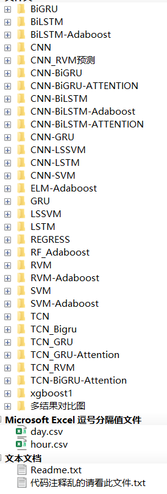

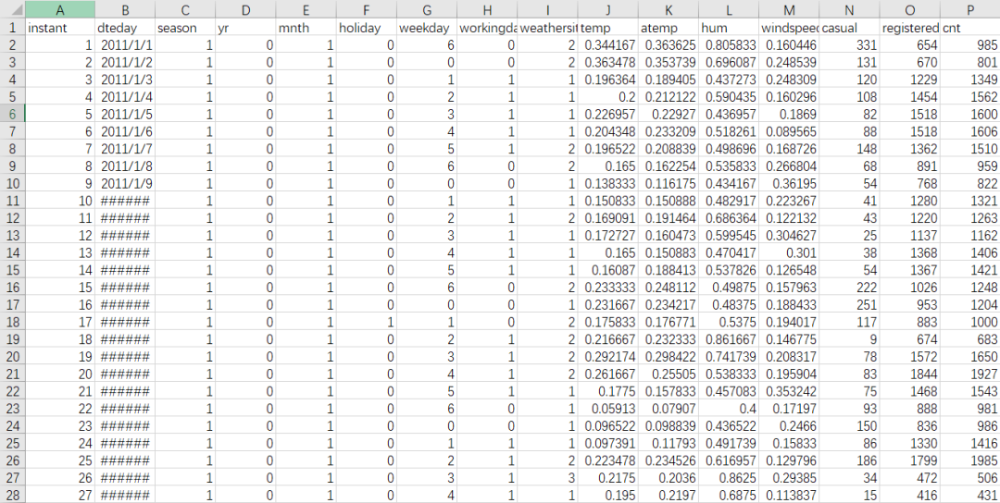
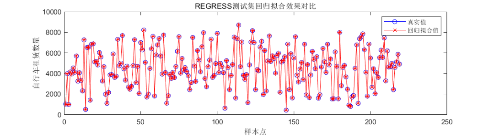
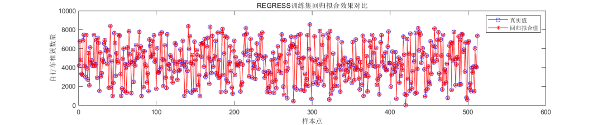
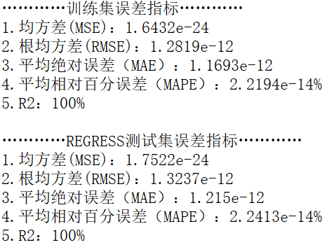
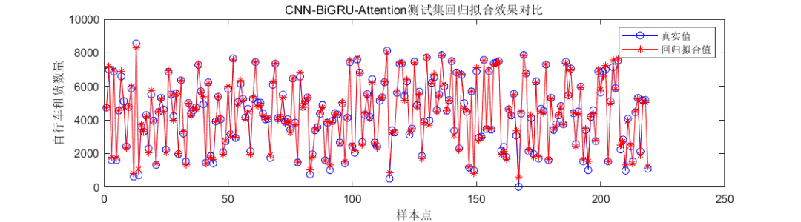
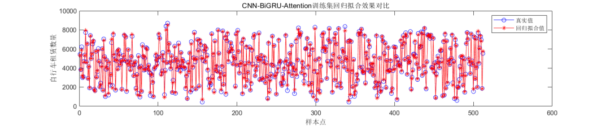
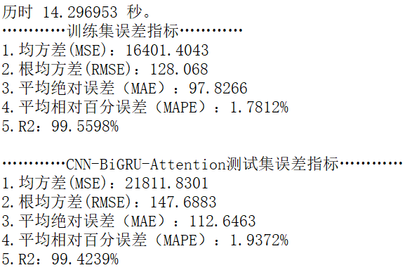
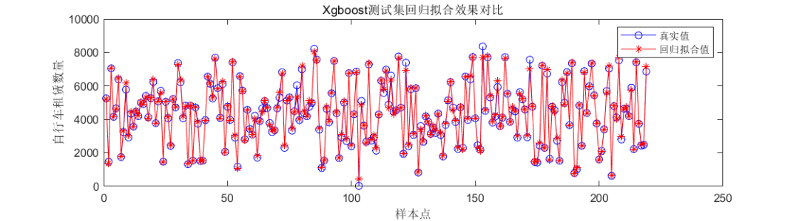
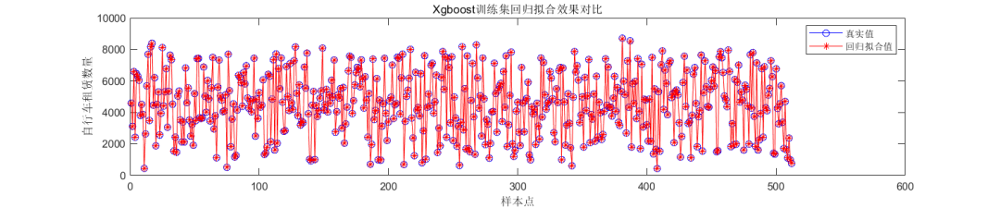
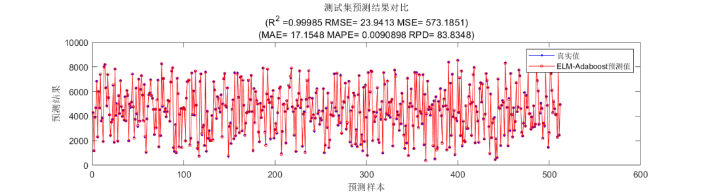
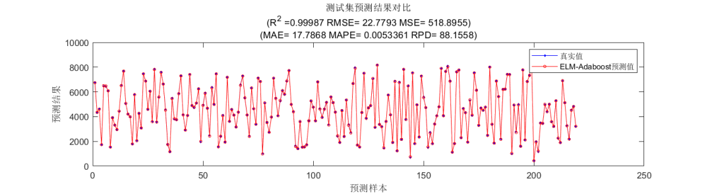
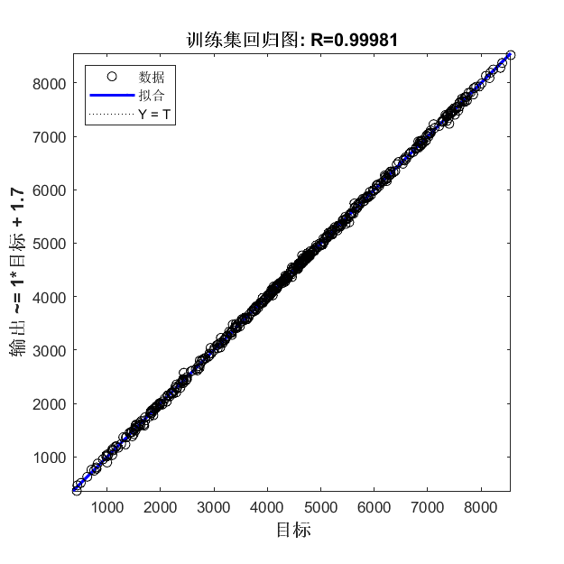
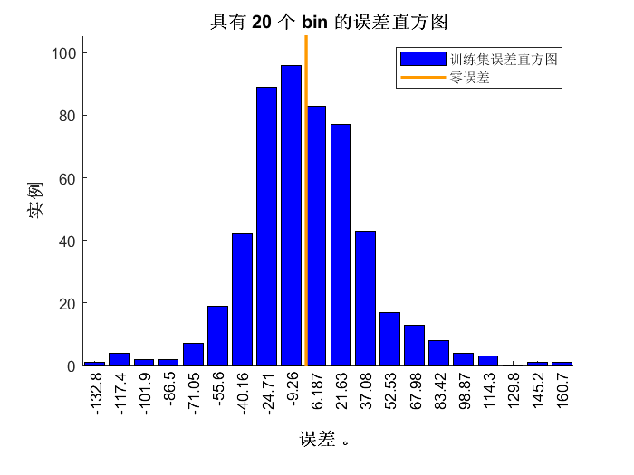

<!-- PAYMENT_BLOCK -->

## Get this dataset

- Payment link (Stripe): [Buy now](https://buy.stripe.com/3cs8yP7sY87d0vu9AB)
- Payment QR code: 

<!-- /PAYMENT_BLOCK -->
